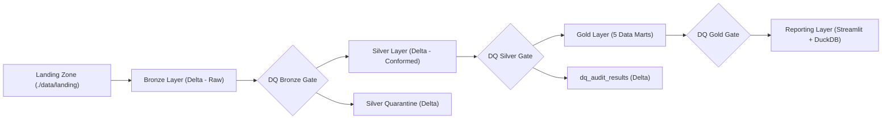

# Lakehouse Architecture Design Document

> **Instructions:** Complete each section below as you design and build your Medallion Lakehouse pipeline. Replace all `<!-- TODO: ... -->` placeholders with your concrete implementation choices, schema conventions, and Spark UI evidence. Refer to [`STUDENT_ASSIGNMENT.md`](./STUDENT_ASSIGNMENT.md) and [`SANITY_CHECKS.md`](./SANITY_CHECKS.md) for requirements.

---

## 1. System & Medallion Architecture Diagram

<!-- TODO: Expand this Mermaid diagram to reflect all 10 Bronze tables, your Silver cleansed & quarantine tables, the 5 Gold marts, DQ gates, Airflow orchestration, and the Streamlit/DuckDB reporting layer. -->



---

## 2. Storage Format & Partitioning Strategy

<!-- TODO: Document your Delta Lake directory structure, partitioning keys, and idempotent write strategy (e.g., overwrite vs. replaceWhere / Delta MERGE / delete+append by _batch_date). -->

| Layer | Path Pattern | Partition Column(s) | Write / Idempotency Strategy |
| :--- | :--- | :--- | :--- |
| **Bronze (Full Load)** | `lakehouse/bronze/<table>` | None | Overwrite snapshot |
| **Bronze (Daily Batch)** | `lakehouse/bronze/<table>` | `_batch_date` | <!-- TODO: e.g. replaceWhere or delete + append --> |
| **Silver** | `lakehouse/silver/<table>` | <!-- TODO --> | <!-- TODO --> |
| **Silver Quarantine** | `lakehouse/silver_quarantine/<table>` | `_batch_date` | Delete `_batch_date` + append |
| **Gold** | `lakehouse/gold/<table>` | <!-- TODO --> | <!-- TODO --> |
| **DQ Audit** | `lakehouse/dq/dq_audit_results` | `batch_date` | Delete `(batch_date, layer, table_name)` + append |

---

## 3. SCD Type 2 Design (`silver_employees_scd2`)

<!-- TODO: Document your SCD Type 2 design in detail:
1. Interval convention: Closed `[valid_from, valid_to]` vs. Half-open `[valid_from, valid_to)` and what sentinel value (e.g. `9999-12-31` or `NULL`) is used for `is_current = true`.
2. Tracked attributes (`department`, `role`, `hourly_rate_eur`, `is_active`, `termination_date`, `churn_type`).
3. How consecutive snapshots without attribute changes are collapsed or skipped.
4. Exact point-in-time join predicate used in `gold_project_profitability` when joining `silver_timesheets` on `work_date`.
-->

- **Interval Convention:** Half-open `[valid_from, valid_to)` — `valid_from` is included (`work_date >= valid_from`) and `valid_to` is excluded (`work_date < valid_to`).
- **Open-End Sentinel:** `NULL` — current (`is_current = true`) rows use `valid_to = NULL` to represent an open-ended validity interval.
- **Point-in-Time Join Condition:**
  ```sql
  ts.emp_id = emp.emp_id AND ts.work_date >= emp.valid_from AND (emp.valid_to IS NULL OR ts.work_date < emp.valid_to)
  ```

#### Example (`EMP_0496` rate change, as of January 3, 2026)

As of January 3, 2026, `EMP_0496`'s `hourly_rate_eur` changed from `48.79` (observed in the `2026-01-01` and `2026-01-02` snapshots) to `54.17` starting on `2026-01-03`:

| `emp_id` | `hourly_rate_eur` | `valid_from` (inclusive) | `valid_to` (exclusive) | `is_current` |
| :--- | ---: | :---: | :---: | :---: |
| `EMP_0496` | `48.79` | `2026-01-01` | `2026-01-03` | `false` |
| `EMP_0496` | `54.17` | `2026-01-03` | `NULL` | `true` |

Under `[valid_from, valid_to)`, a timesheet on `2026-01-02` matches the first record (`48.79`), while a timesheet on `2026-01-03` matches the current record (`54.17`, with `valid_to = NULL`) with no overlap.

---

## 4. Near-Duplicate Tie-Breaker Policy

<!-- TODO: Document your deterministic tie-breaker rule (`Window.partitionBy(id).orderBy(...)`) for resolving exact and near-duplicates in `timesheets` (`ts_id`), `expenses` (`exp_id`), and `employee_surveys` (`survey_id`). Explain why it is deterministic across re-runs. -->

| Dataset | Business Key | Tie-Breaker Ordering Rule | Rationale |
| :--- | :--- | :--- | :--- |
| `timesheets` | `ts_id` | <!-- TODO --> | <!-- TODO --> |
| `expenses` | `exp_id` | <!-- TODO --> | <!-- TODO --> |
| `employee_surveys` | `survey_id` | <!-- TODO --> | <!-- TODO --> |

---

## 5. Spark Shuffle Skew Analysis (`crm_events` — `VIP_CORP_001`)

`VIP_CORP_001` accounts for roughly **45%** of all `crm_events` rows, causing severe skew during distributed joins/aggregations against `silver_clients`.

<!-- TODO: Document:
1. Baseline skewed run behavior (what went wrong / long tail task durations).
2. Skew mitigation technique implemented (e.g., Broadcast Join, Spark AQE skew join, or Key Salting — explain why and include Spark configs/salting factor).
3. Before vs. After metrics from the Spark UI / Spark History Server (`http://localhost:18080`).
4. Embed or link Spark UI screenshots saved under `docs/images/` (do not commit huge binaries if avoidable; keep compressed PNGs small).
-->

### Before vs. After Skew Mitigation Metrics

| Metric | Unoptimized (Skewed Shuffle Join) | Optimized (Your Strategy) |
| :--- | :---: | :---: |
| **Strategy / Config** | Sort-Merge Join (default) | <!-- TODO --> |
| **Stage Duration** | <!-- TODO --> | <!-- TODO --> |
| **Max Task Duration vs. Median** | <!-- TODO --> | <!-- TODO --> |
| **Max Shuffle Read Size per Task** | <!-- TODO --> | <!-- TODO --> |
| **Spill (Memory / Disk)** | <!-- TODO --> | <!-- TODO --> |

### Spark UI Screenshots

<!-- TODO: Add screenshots showing stage task summary / event timeline before and after optimization. -->
- **Baseline (Skewed):** `<!-- TODO: add screenshot link -->`
- **Optimized:** `<!-- TODO: add screenshot link -->`

---

## 6. Data Quality & Quarantine Architecture

<!-- TODO: List all Hard (`severity = ERROR`) and Soft (`severity = WARN`) checks implemented across Bronze, Silver, and Gold, along with quarantine routing rules and threshold justifications. -->

| Layer | Table | Check Name | Severity | Rule / Threshold | Action on Failure |
| :--- | :--- | :--- | :---: | :--- | :--- |
| Silver | `silver_clients` | `not_null_client_id` | `ERROR` | `client_id IS NOT NULL` (Reference sample) | Fail task |
| <!-- TODO --> | <!-- TODO --> | <!-- TODO --> | <!-- TODO --> | <!-- TODO --> | <!-- TODO --> |

---

## 7. Orchestration & Reporting Layer Design

<!-- TODO: Summarize your Airflow DAG schedule, task dependencies, retry/timeout policies, Gold mart refresh pattern, and how DuckDB reads Delta tables in Streamlit. -->
